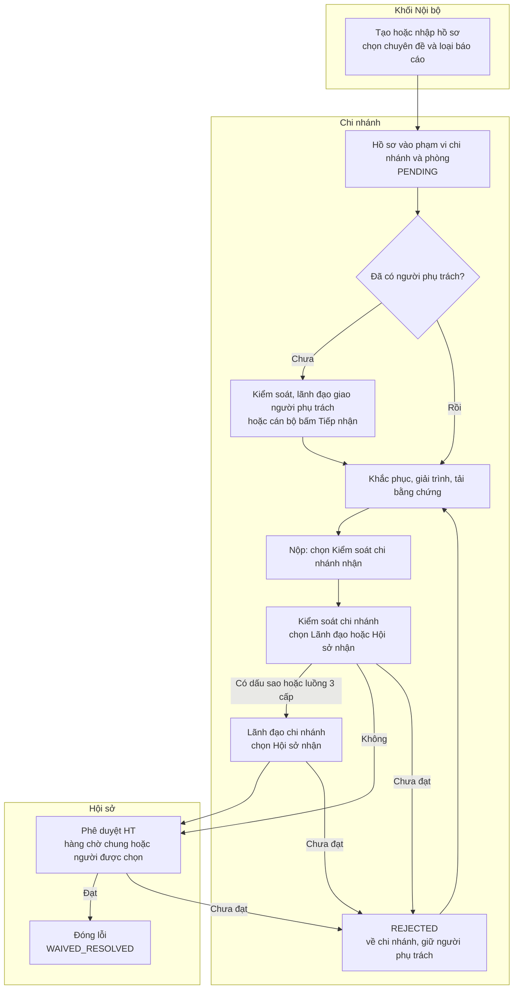
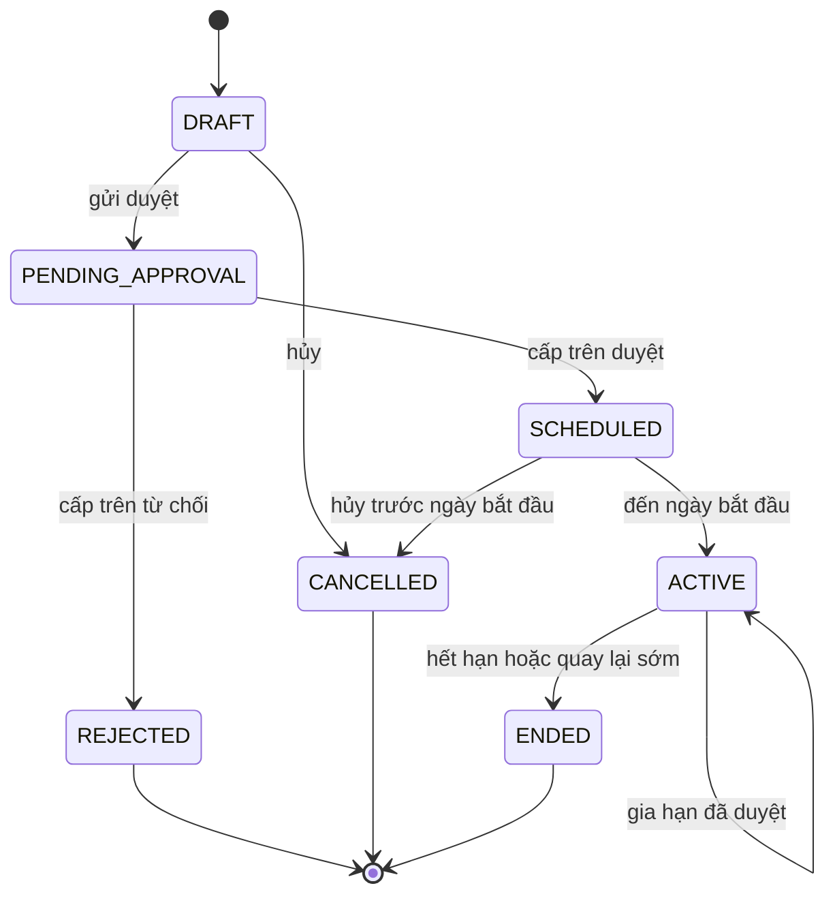
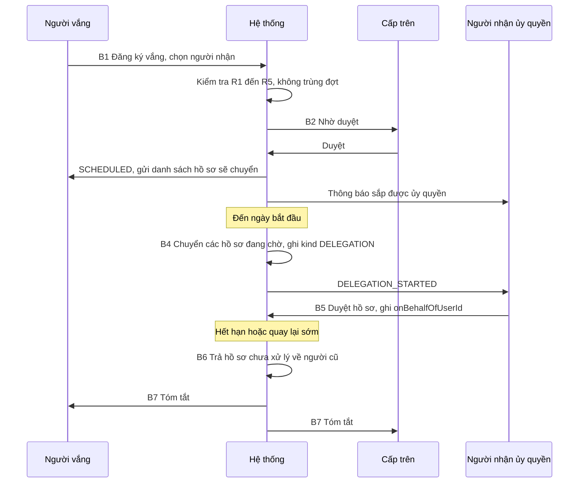
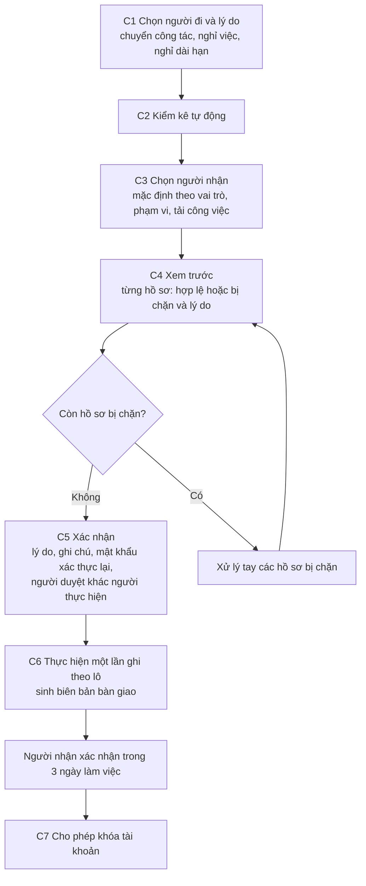
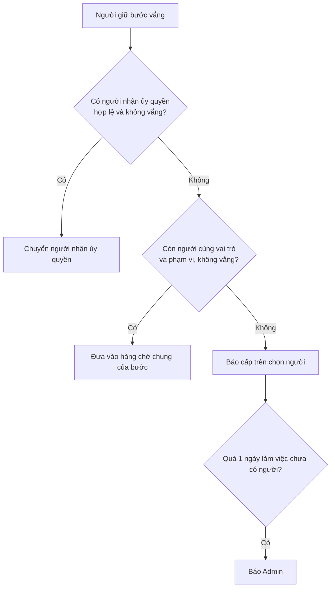

# Luồng giao hồ sơ, ủy quyền khi vắng mặt và bàn giao

> Bản thiết kế ngày 15/11/2026, đối chiếu mã nguồn trên nhánh `main`.
> Mục 1 mô tả hiện trạng đã kiểm chứng trong code. Từ mục 2 trở đi là thiết kế đề xuất.
> **Pha 0 (mục 15) đã có trong ứng dụng từ 15/11/2026**: chặn khóa, xóa, chuyển chi nhánh khi còn hồ sơ; kiểm kê; bàn giao hàng loạt cho Admin. Các pha còn lại chưa có.
> Luồng duyệt hiện có xem ở [LUU_DO_VAN_HANH_CHI_TIET.md](./LUU_DO_VAN_HANH_CHI_TIET.md).

## 1. Hiện trạng và khoảng trống

| Nhu cầu | Hiện có trong code | Khoảng trống |
|---|---|---|
| Ai chịu trách nhiệm khắc phục một hồ sơ | Hồ sơ hiện theo phạm vi chi nhánh và phòng. **Tiếp nhận công việc** (`PUT /workspace/accepted`) chỉ là đánh dấu cá nhân, không ghi người phụ trách lên hồ sơ | Hai cán bộ cùng phòng đều nộp được cùng một hồ sơ; không ai chịu trách nhiệm rõ ràng |
| Chọn người duyệt bước kế tiếp | Người chuyển chọn từ danh sách server lọc (`GET /findings/:id/next-approvers`) | Danh sách không biết ai đang vắng |
| Giao lại người duyệt | `POST /findings/:id/approval-route/reassign`, chỉ ADMIN, đúng bước đang chờ, có lý do và `validUntil` tùy chọn | Admin là nút cổ chai. Hết hạn thì người được giao bị chặn (409 `APPROVAL_ASSIGNMENT_EXPIRED`) và hồ sơ đứng chờ Admin giao tiếp; không có cơ chế tự trả về người cũ |
| Người nghỉ phép, công tác, ốm | Không có khái niệm vắng mặt | Hồ sơ ghim vào người vắng đứng yên đến khi họ quay lại |
| Khóa hoặc xóa tài khoản | Trước Pha 0, `PATCH` và `DELETE /admin/users/:id` chỉ thu hồi phiên đăng nhập. Từ Pha 0 trả 409 `USER_HAS_OPEN_ITEMS` khi người đó còn giữ bước duyệt | Chưa chặn khi đổi vai trò hoặc đổi phòng, cụm của người đang giữ hồ sơ |
| Bàn giao khi chuyển công tác | Từ Pha 0: nút **Bàn giao** ở Quản trị, Người dùng; Admin chuyển các bước duyệt đang giữ sang một người, một lần ghi | Chưa có biên bản, xác nhận của người nhận, hoàn tác, chia cho nhiều người trong một lần |
| Báo khi hồ sơ kẹt | Màn Chính sách SLA và cảnh báo đang ghi "Chưa hoạt động"; worker SLA lúc 08:30 chỉ cập nhật trạng thái SLA | Không ai được báo khi hồ sơ nằm lâu ở một bước |
| Gia hạn SLA | Có kiểu `SlaExtensionRequest` | Chưa có route |

Rủi ro lớn nhất trước Pha 0 là dòng "Khóa hoặc xóa tài khoản": một lần khóa tài khoản có thể làm đứng nhiều hồ sơ mà không có cảnh báo nào. Pha 0 đã chặn rủi ro này cho khóa, xóa và chuyển chi nhánh.

## 2. Nguyên tắc

1. Tại mỗi thời điểm, mỗi hồ sơ ở mỗi bước chỉ có một người chịu trách nhiệm.
2. **Ủy quyền** cho người khác hành động thay trong thời hạn, trách nhiệm cuối cùng vẫn thuộc người ủy quyền. **Bàn giao** chuyển trách nhiệm sang người khác.
3. Không mở rộng phạm vi dữ liệu. Người nhận phải sẵn có quyền xem hồ sơ theo phạm vi đã cấp (`ALL`, `CLUSTER`, `BRANCH`, `DEPARTMENT`).
4. Tách biệt nhiệm vụ. Không ai giữ hai bước của cùng một hồ sơ và không ai duyệt hồ sơ mình nộp, kể cả khi nhận ủy quyền.
5. Mọi thay đổi có lý do, thời hạn, người thực hiện, người duyệt và được ghi vào nhật ký không sửa được.
6. Không để hồ sơ không có người. Khóa tài khoản bị chặn khi còn hồ sơ; hết hạn ủy quyền thì hồ sơ tự quay về.
7. Thao tác hàng loạt chạy trong một lần ghi, có xem trước và hoàn tác theo lô.
8. SLA không dừng khi có người vắng. Muốn lùi hạn phải gia hạn có duyệt.

## 3. Thuật ngữ

| Thuật ngữ | Nghĩa | Trạng thái |
|---|---|---|
| Giao việc | Chỉ định người phụ trách khắc phục một hồ sơ khách hàng | Đề xuất |
| Giao lại | Admin đổi người duyệt của bước đang chờ | Đã có |
| Ủy quyền tạm thời | Người vắng cho người khác duyệt thay trong một khoảng ngày | Đề xuất |
| Bàn giao | Chuyển toàn bộ hồ sơ tồn đọng sang người khác, có biên bản | Đề xuất |
| Tiếp quản | Người cùng phòng nhận một hồ sơ đang có người phụ trách, kèm lý do | Đề xuất |
| Người hiệu lực | Người thực sự được phép duyệt một bước tại thời điểm hiện tại, sau khi tính ủy quyền | Đề xuất |

## 4. Chọn cơ chế theo tình huống

| Tình huống | Cơ chế | Ai khởi tạo | Ai duyệt | Thời hạn | Kết thúc |
|---|---|---|---|---|---|
| Nghỉ phép, công tác, đào tạo có kế hoạch | Ủy quyền tạm thời | Chính người vắng | Cấp trên trực tiếp (mục 12) | Từ ngày đến ngày, tối đa 30 ngày | Tự thu hồi |
| Nghỉ ốm đột xuất, chưa kịp ủy quyền | Ủy quyền khẩn | Cấp trên hoặc Admin đăng ký thay | Có hiệu lực ngay, người còn lại hậu kiểm trong 2 ngày làm việc | Đến ngày dự kiến quay lại, gia hạn được | Tự thu hồi |
| Nghỉ dài hạn trên 30 ngày (thai sản, không lương) | Bàn giao tạm | Cấp trên | Admin | Không giới hạn | Thủ công khi quay lại |
| Chuyển công tác, nghỉ việc | Bàn giao vĩnh viễn | Cấp trên hoặc Admin | Admin, kèm xác nhận của người nhận | Không áp dụng | Khóa tài khoản sau khi hoàn tất |
| Giao nhầm người, người quá tải | Giao lại hoặc Tiếp quản | Người giữ hồ sơ hoặc cấp trên | Theo mục 12 | Không áp dụng | Không áp dụng |
| Người nhận ủy quyền cũng vắng | Chuỗi dự phòng (mục 8) | Hệ thống | Không cần | Theo đợt vắng | Tự động |
| Không ai nhận | Hàng chờ chung và leo thang (mục 8) | Hệ thống | Không cần | Theo ngưỡng | Tự động |

## 5. Luồng A: giao hồ sơ bình thường

Quy tắc bổ sung so với hiện tại:

- Người phụ trách gắn theo **hồ sơ khách hàng** (CIF trong một chi nhánh), áp cho mọi mã lỗi của khách hàng đó, cùng cách dấu sao đang gắn theo khách hàng. Từng mã lỗi có thể đổi riêng khi cần.
- Ai giao được: BRANCH_CONTROLLER, BRANCH_LEADER trong chi nhánh; INTERNAL_OFFICER, ADMIN trong phạm vi của họ. Cán bộ tự nhận chỉ khi hồ sơ chưa có người phụ trách.
- Giai đoạn đầu dùng khóa mềm: người khác cùng phòng vẫn thao tác được nhưng màn hình hiện tên người phụ trách và yêu cầu bấm **Tiếp quản** kèm lý do. Khóa cứng bật bằng cấu hình sau khi luồng ủy quyền chạy ổn.
- Nộp lại sau khi bị trả về giữ nguyên người phụ trách.

## 6. Luồng B: vắng mặt và ủy quyền tạm thời

### 6.1 Trạng thái của một đợt vắng

### 6.2 Các bước

| Bước | Việc | Kiểm tra của hệ thống |
|---|---|---|
| B1 Đăng ký | Người vắng nhập từ ngày, đến ngày, loại vắng (phép, công tác, đào tạo, ốm, khác), người được ủy quyền, ghi chú chung | Người nhận đủ điều kiện (mục 9, R1 đến R5); không trùng đợt khác; thời hạn không quá mức cho phép; ngày bắt đầu không ở quá khứ, trừ ủy quyền khẩn |
| B2 Duyệt | Cấp trên trực tiếp duyệt. BRANCH_INPUT chỉ cần thông báo, không cần duyệt | Quá 1 ngày làm việc chưa duyệt thì nhắc, quá 2 ngày báo Admin |
| B3 Lên lịch | Trạng thái SCHEDULED. Hiện cho cả hai bên danh sách hồ sơ sẽ chuyển | Danh sách tính lại mỗi khi mở, vì hồ sơ thay đổi hằng ngày |
| B4 Kích hoạt | Lúc 00:05 ngày bắt đầu, hoặc ngay ở yêu cầu đầu tiên sau mốc đó (không phụ thuộc cron). Với mỗi hồ sơ đang chờ ở bước của người vắng: ghi một lần giao với `kind = DELEGATION`, người cũ, người nhận, `validUntil` = 23:59 giờ Việt Nam của ngày cuối | Mỗi hồ sơ kiểm `expectedVersion`; hồ sơ vừa đổi được bỏ qua và đưa vào danh sách xử lý tay |
| B5 Trong thời gian vắng | Hồ sơ mới đến bước đó đi thẳng tới người nhận. Danh sách người nhận hiện "Nguyễn A (thay Trần B đến 20/11)". Người nhận thấy hồ sơ ở nhóm **Nhận ủy quyền**; mọi thao tác ghi `onBehalfOfUserId` | Người vắng đăng nhập vẫn đọc được nhưng không duyệt được (409 `DELEGATED_AWAY`), tránh hai người cùng xử lý |
| B6 Kết thúc | Tự động lúc 23:59 ngày cuối, hoặc người vắng bấm **Quay lại sớm**, hoặc gia hạn trước khi hết (cần duyệt lại) | Hồ sơ còn ở bước đó và chưa được xử lý trả về người cũ; hồ sơ đã chuyển bước giữ nguyên lịch sử |
| B7 Tổng kết | Gửi người vắng và cấp trên bản tóm tắt: đã xử lý bao nhiêu, trả lại bao nhiêu, hồ sơ nào kẹt | |

### 6.3 Trình tự

### 6.4 Cách thực hiện trong code

Cơ chế hiện có đã đủ nền: mọi kiểm tra duyệt đều dựa trên người được ghim trong `approvalRoute` (`assertSelectedApprover`). Vì vậy ủy quyền dùng đúng cơ chế giao lại đang có (`reassignApprovalStage` với `validUntil`), thêm `kind` và `onBehalfOfUserId` vào lịch sử giao, và thêm một việc nền tự trả hồ sơ khi hết hạn. Cách này không phải sửa các lệnh duyệt.

## 7. Luồng C: bàn giao khi chuyển công tác hoặc nghỉ việc

Kiểm kê (C2) gồm năm nhóm:

1. Hồ sơ khắc phục đang giao cho người đó.
2. Hồ sơ đang chờ người đó duyệt, theo từng bước.
3. Hồ sơ người đó đang ủy quyền đi hoặc đang nhận ủy quyền.
4. Khách hàng, chi nhánh người đó đang tiếp nhận hoặc theo dõi.
5. Vị trí trưởng nhóm nội bộ (`leaderUserId`) nếu có.

Quy tắc thực hiện:

- Chia được cho nhiều người nhận, theo phòng, chuyên đề hoặc mã lỗi.
- Toàn lô chạy trong **một lần ghi** với một khóa chống lặp theo lô. Làm từng hồ sơ một sẽ rất chậm vì chi phí mỗi lần ghi hiện tăng theo tổng số hồ sơ (đo được khoảng 1,9 giây mỗi lần ở 20.000 hồ sơ).
- Hồ sơ đã đổi phiên bản trong lúc xem trước được bỏ qua và liệt kê riêng, không làm hỏng cả lô.
- Biên bản bàn giao lưu danh sách hồ sơ, người cũ, người mới, ghi chú từng hồ sơ, người thực hiện, người duyệt, giờ xác nhận.
- Hoàn tác theo lô trong 24 giờ nếu người nhận chưa thao tác trên hồ sơ nào của lô.
- **Chặn khóa và xóa tài khoản** khi còn hồ sơ: trả 409 `USER_HAS_OPEN_ITEMS` kèm đường dẫn mở trình bàn giao. Xóa dùng xóa mềm để giữ lịch sử.

## 8. Luồng D: hồ sơ kẹt và leo thang

Ngưỡng tính theo ngày làm việc, dùng lịch nghỉ lễ của SLA (`holidayDates`). Giá trị mặc định cấu hình được theo loại báo cáo.

| Thời gian đứng ở một bước | Hành động | Người nhận cảnh báo |
|---|---|---|
| Quá 2 ngày | Nhắc người giữ bước | Người giữ bước |
| Quá 4 ngày | Báo cấp trên | Kiểm soát chi nhánh: Lãnh đạo chi nhánh. Lãnh đạo chi nhánh: Admin và Lãnh đạo khối nội bộ. Phê duyệt HT: Lãnh đạo khối nội bộ |
| Quá 6 ngày | Đưa về hàng chờ chung của bước và báo Admin | Admin |

Chuỗi dự phòng khi người giữ bước vắng:

## 9. Quy tắc chặn

| Mã | Điều kiện | HTTP |
|---|---|---|
| R1 `ABSENCE_DELEGATE_INELIGIBLE` | Người nhận không hoạt động, thiếu vai trò của bước, hoặc không có quyền xem hồ sơ trong phạm vi | 422 |
| R2 `ABSENCE_SELF_DELEGATE` | Người nhận là chính người vắng | 422 |
| R3 `DELEGATION_CHAIN_FORBIDDEN` | Người nhận đang vắng hoặc đã ủy quyền tiếp cho người khác (chỉ cho một cấp) | 422 |
| R4 `ABSENCE_OVERLAP` | Trùng một đợt vắng khác của cùng người | 409 |
| R5 `ABSENCE_TOO_LONG` | Vượt thời hạn tối đa; dùng bàn giao tạm | 422 |
| R6 `DELEGATED_AWAY` | Người vắng duyệt trong lúc ủy quyền đang hiệu lực | 409 |
| R7 `HANDOVER_RECIPIENT_INELIGIBLE` | Người nhận bàn giao thiếu vai trò hoặc phạm vi cho hồ sơ đó | 422 |
| R8 `HANDOVER_ITEM_CHANGED` | Hồ sơ đổi phiên bản sau khi xem trước | 409 |
| R9 `HANDOVER_APPROVER_SAME_AS_ACTOR` | Người duyệt bàn giao trùng người thực hiện | 403 |
| R10 `USER_HAS_OPEN_ITEMS` | Khóa hoặc xóa tài khoản khi còn hồ sơ đang giữ | 409 |

Ngoài ra luôn áp luật hiện có: người nhận không phải người nộp, không giữ bước nào khác của cùng hồ sơ (`eligibleRecipientsForStage`).

## 10. Dữ liệu và API đề xuất

### 10.1 Dữ liệu

| Đối tượng | Trường chính |
|---|---|
| `user_absences` | `id`, `userId`, `fromDate`, `toDate`, `kind`, `status`, `delegateUserId`, `requestedBy`, `approvedBy`, `note`, `createdAt` |
| `handover_batches` | `id`, `fromUserId`, `kind` (`TRANSFER`, `RESIGNATION`, `LONG_LEAVE`), `status`, `createdBy`, `approvedBy`, `note`, `executedAt`, `acknowledgedAt` |
| `handover_items` | `batchId`, `findingId`, `stage`, `fromUserId`, `toUserId`, `result`, `note` |
| `approval_assignment_history` (mở rộng, nền đã có ở migration 0127, 0128) | thêm `kind` (`REASSIGN`, `DELEGATION`, `HANDOVER`, `REVERT`), `onBehalfOfUserId`, `handoverId` |
| Hồ sơ | thêm `remediationOwnerUserId` |

Ngày vắng lưu dạng `YYYY-MM-DD` theo lịch Việt Nam, không lưu giờ, để không lệch múi giờ.

### 10.2 Endpoint

| Endpoint | Việc |
|---|---|
| `POST /absences`, `GET /absences?scope=mine,pending,active` | Đăng ký và xem |
| `POST /absences/:id/approve`, `/reject`, `/cancel`, `/extend`, `/end-early` | Chuyển trạng thái |
| `GET /absences/:id/preview` | Hồ sơ sẽ bị ảnh hưởng |
| `GET /admin/users/:id/open-items?toUserId=` | Kiểm kê hồ sơ đang giữ; có `toUserId` thì đánh dấu hồ sơ nào người đó nhận được (**đã có**, Pha 0) |
| `POST /admin/handovers` | Thực hiện theo lô, một lần ghi, cần xác thực lại mật khẩu (**đã có**, Pha 0). Phần xem trước nằm trong `open-items` ở trên |
| `GET /handovers/:id`, `POST /handovers/:id/acknowledge`, `POST /handovers/:id/undo` | Biên bản, xác nhận, hoàn tác |
| `PUT /customers/:cif/owner` | Giao người phụ trách khách hàng |
| `GET /findings/:id/next-approvers` (mở rộng) | Thêm nhãn người vắng và người thay thế |

Lệnh workflow mới trong `workflowCommands`: `DELEGATE_APPROVAL`, `REVERT_DELEGATION`, `HANDOVER_ITEM`, `SET_REMEDIATION_OWNER`, `ESCALATE_STALLED`.

### 10.3 Thông báo (outbox)

| Sự kiện | Gửi cho | Thời điểm |
|---|---|---|
| `ABSENCE_REQUESTED` | Cấp trên | Khi gửi duyệt |
| `ABSENCE_APPROVED` | Người vắng, người nhận | Khi duyệt |
| `DELEGATION_STARTED` | Người nhận, người vắng | 00:05 ngày bắt đầu |
| `DELEGATION_ENDING` | Người nhận, người vắng | Trước 1 ngày làm việc |
| `DELEGATION_ENDED` | Người vắng, cấp trên | Khi kết thúc, kèm tóm tắt |
| `HANDOVER_EXECUTED` | Người nhận, người cũ, cấp trên | Khi thực hiện |
| `HANDOVER_ACK_REMINDER` | Người nhận | Còn 1 ngày hết hạn xác nhận |
| `ITEM_STALLED_REMINDER`, `ITEM_STALLED_ESCALATED` | Theo mục 8 | Khi quá ngưỡng |

Mỗi sự kiện có `dedupeKey` để không gửi trùng, theo cơ chế outbox đang dùng.

## 11. Giao diện

| Màn hình | Nội dung |
|---|---|
| Tài khoản cá nhân, mục **Vắng mặt và ủy quyền** | Biểu mẫu B1. Dùng `<input type="date">`, báo lỗi sau khi người dùng đã thao tác, tóm tắt lỗi đọc được bằng trình đọc màn hình |
| Danh sách **Người nhận** khi nộp hoặc chuyển | Người vắng hiện nhãn "Vắng đến 20/11, ủy quyền cho X"; mặc định gợi ý bỏ qua người vắng |
| Việc của tôi | Nhóm mới **Nhận ủy quyền** và **Bàn giao chờ xác nhận**; nhãn "Thay cho A" trên hồ sơ và trong lịch sử |
| Quản trị, mục **Bàn giao** | Trình hướng dẫn 5 bước theo luồng C; bảng xem trước phân trang; xuất CSV biên bản |
| Banner khi người vắng đăng nhập | "Bạn đang ủy quyền đến 20/11" kèm nút **Quay lại sớm** |
| Hộp xác nhận và nhập lại mật khẩu | Dùng phần tử `<dialog>` gốc với `showModal()`, ô mật khẩu `type="password"` và `autocomplete="current-password"`. Không dùng `window.prompt` vì nó hiện mật khẩu dạng chữ thường |

## 12. Phân quyền

Cấp trên trực tiếp để duyệt ủy quyền, theo vai trò hiện có:

| Người vắng | Người duyệt |
|---|---|
| BRANCH_INPUT | Không cần duyệt, chỉ thông báo cho Kiểm soát chi nhánh |
| BRANCH_CONTROLLER | BRANCH_LEADER cùng chi nhánh |
| BRANCH_LEADER | ADMIN hoặc SUPERVISOR được chỉ định |
| INTERNAL_OFFICER, INTERNAL_APPROVER | SUPERVISOR |
| SUPERVISOR | ADMIN |

| Hành động | Chính người vắng | Cấp trên trực tiếp | ADMIN | Người nhận |
|---|---|---|---|---|
| Đăng ký, hủy, gia hạn vắng | Có | Có (đăng ký thay) | Có | Không |
| Duyệt ủy quyền | Không | Có | Có | Không |
| Quay lại sớm | Có | Có | Có | Không |
| Thực hiện bàn giao | Không | Có | Có | Không |
| Duyệt bàn giao | Không | Không | Có | Không |
| Xác nhận đã nhận | Không | Không | Không | Có |
| Giao người phụ trách khách hàng | Không | Có (BRANCH_CONTROLLER, BRANCH_LEADER, INTERNAL_OFFICER) | Có | Không |

Mọi hành động trên chỉ chạy trong phạm vi dữ liệu của người thực hiện. ADMIN vẫn không tự duyệt nghiệp vụ, đúng ma trận hiện có.

## 13. Nhật ký và báo cáo

Mỗi dòng nhật ký ghi: người thực hiện, vai trò, hồ sơ, bước, người cũ, người mới, `kind`, lý do, `onBehalfOfUserId`, mã đợt vắng hoặc mã lô bàn giao, giờ. Nhật ký không sửa được, đi cùng sổ sự kiện workflow hiện có.

Báo cáo mới:

1. Hồ sơ đang đứng ở người vắng.
2. Ủy quyền đang hiệu lực và sắp hết hạn.
3. Biên bản bàn giao theo tháng.
4. Hồ sơ kẹt quá ngưỡng, theo bước và chi nhánh.
5. Người nhận ủy quyền xử lý nhiều bất thường (phát hiện lạm dụng ủy quyền).

## 14. Tiêu chí nghiệm thu

1. Cho đợt vắng đã duyệt, khi đến ngày bắt đầu, mọi hồ sơ đang chờ người vắng chuyển sang người nhận, mỗi hồ sơ có một dòng lịch sử `DELEGATION`.
2. Khi người vắng duyệt một hồ sơ trong lúc ủy quyền hiệu lực, hệ thống trả 409 `DELEGATED_AWAY` và hồ sơ không đổi.
3. Khi người nhận duyệt, lịch sử ghi "Duyệt thay A" và `onBehalfOfUserId` đúng.
4. Khi hết hạn, hồ sơ chưa xử lý trở về người cũ trong cùng ngày; hồ sơ đã chuyển bước giữ nguyên.
5. Chọn người nhận ủy quyền thiếu quyền xem hồ sơ trong phạm vi: 422, không có thay đổi nào.
6. Người nhận ủy quyền cũng đang vắng: 422 `DELEGATION_CHAIN_FORBIDDEN`.
7. Người nhận ủy quyền là người đã nộp hồ sơ đó: không được nhận hồ sơ đó (luật tách biệt nhiệm vụ).
8. Khóa tài khoản còn giữ hồ sơ: 409 `USER_HAS_OPEN_ITEMS`; sau khi biên bản bàn giao hoàn tất thì khóa được.
9. Bàn giao 200 hồ sơ chạy trong một lần ghi và có đúng một biên bản; hồ sơ đổi phiên bản giữa chừng được liệt kê riêng.
10. Người duyệt bàn giao trùng người thực hiện: 403.
11. Hoàn tác lô trong 24 giờ trả đúng người cũ cho mọi hồ sơ chưa bị thao tác; hồ sơ đã bị thao tác được báo lại.
12. Hồ sơ đứng quá 4 ngày làm việc ở một bước làm cấp trên nhận cảnh báo đúng một lần (không gửi trùng).
13. Trong mọi trường hợp, người dùng không đọc được hồ sơ ngoài phạm vi đã cấp.

## 15. Lộ trình

| Pha | Nội dung | Phụ thuộc |
|---|---|---|
| 0 (**đã làm**) | Chặn khóa, xóa và chuyển chi nhánh khi còn hồ sơ (R10); kiểm kê hồ sơ đang giữ; bàn giao hàng loạt của Admin dùng cơ chế giao lại đang có, một lần ghi. Chỉ chuyển sang một người nhận mỗi lần; chia cho nhiều người thì bàn giao nhiều lần. Chưa có biên bản, xác nhận, hoàn tác (thuộc Pha 3) | Không |
| 1 | Vắng mặt và ủy quyền (luồng B), hiển thị người vắng trong danh sách người nhận, việc nền tự trả hồ sơ, thông báo | Email outbox chạy ở production |
| 2 | Người phụ trách khách hàng (luồng A), nhắc và leo thang hồ sơ kẹt (luồng D) | Pha 1 |
| 3 | Bàn giao có biên bản và xác nhận (luồng C đầy đủ), báo cáo, gia hạn SLA | Pha 0 và 1 |

Pha 0 nên làm trước vì nó vá rủi ro thật ở mục 1 với chi phí thấp.

## 16. Điểm cần chốt

| Câu hỏi | Đề xuất |
|---|---|
| Thời hạn ủy quyền tối đa | 30 ngày, cấu hình được |
| Cấp trên có phải duyệt ủy quyền | Có với kiểm soát, lãnh đạo, Hội sở; không với cán bộ chi nhánh |
| Hết hạn thì hồ sơ trả hay ở lại người nhận | Trả về người cũ |
| Người vắng có thao tác được trong lúc ủy quyền | Không, trừ khi quay lại sớm |
| Giao người phụ trách khóa cứng hay mềm | Mềm ở giai đoạn đầu |
| Ngưỡng leo thang | 2, 4, 6 ngày làm việc |
| Ai là cấp trên của Lãnh đạo chi nhánh | Admin hoặc một Lãnh đạo khối nội bộ được chỉ định theo cụm |
